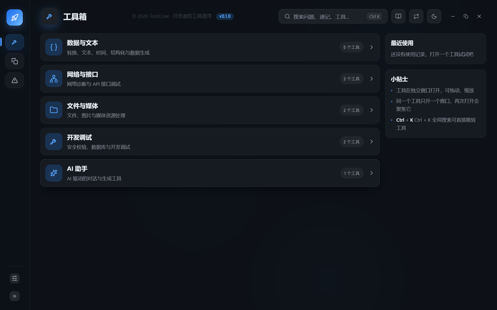

# ToolCove · 工具湾

**A personal agent workbench where the toolbox *is* the action space — local-first, no account, free and open source (MIT).**

Most agent products give you a chat box and a set of cloud tools. Most tool apps give you a pile of
buttons. ToolCove is built on the observation that **you should not have to choose between the two**:
the 27 built-in tools *are* the action space the agent plans over. Every tool you can click is a real
action the planner can call — not a mock, not a thin wrapper around somebody's cloud API.

So the same capability is reachable both ways. Describe the goal in natural language and the agent
picks the actions, chains them, shows every step, and stops for your approval before anything risky
gets written — or just click the tool yourself when you already know what you want.

That is the whole bet: **a workbench where the toolbox and the agent are the same thing.**

It runs as a **Windows desktop app** (Tauri 2) and as a **static web app** in the browser; an
**Android app** is in active rework toward desktop parity
([`docs/mobile-app-plan.md`](docs/mobile-app-plan.md)).



## Features

- **Agent workspace** — the default first screen, and the reason the rest of the app is shaped the
  way it is. Describe a goal; the agent plans over the tool catalog, executes one typed action at a
  time, streams every step (tool, arguments, result, duration), and can be stopped or resumed —
  the run log is persisted, so an interrupted task picks up where it left off. It brings its own
  guard rails rather than trusting the model: every action carries a risk tier
  (`transform` / `read` / `write` / `database`), write actions must produce a diff preview before
  you are asked to approve them, deletions always confirm, and the approval policy itself is
  yours (`risky` / `always` / `never`). Large results are truncated to a `spill:` handle that the
  agent reads back in slices instead of flooding its context. Successful runs can be kept as
  *skills* (up to 50; at most 3 are matched and injected per run, under a fixed token budget) —
  a skill is a hint about what worked last time, never a forced step. Bring your own
  OpenAI-compatible endpoint; nothing is sent anywhere until you ask for it.
- **Toolbox** — 27 built-in tools, each opens in its own draggable/resizable window (the title-bar pin
  keeps a window above all others, so a HUD-style tool can float over a game in borderless mode):

  | Group | Tools |
  |-------|-------|
  | Data & Text | Data conversion (Base64 / URL / Unicode / Hex / JWT / JSON escape), Text processing (regex / replace / line ops / naming / stats, with a line & word diff tab), Table converter (CSV/TSV ↔ JSON / Markdown / SQL INSERT, clean & reshape), Markdown (outline / TOC / lint / format / HTML preview), Structured data (JSON / YAML validate-format-tree-convert), XML (validate / format / XML↔JSON / XPath), JSON Schema (infer / validate / sample / explain structure), Time & schedule (timestamp / timezone / Cron), Data generation (UUID / ULID / NanoID / mock / templates) |
  | Network & API | Network diagnostics (URL / CIDR / DNS / port / ping / route), API debugger (collections & environments), Multi-threaded downloader (chunked resume, batch queue), API capture (watch a local app's requests over CDP, turn one into a check-in site descriptor) |
  | File & Media | File processing (info / encoding / Base64 / line endings / batch rename), Image processing (convert / compress / resize / colors / icon generator / EXIF), Photo archive (shoot on the phone straight into your own object storage — S3-compatible / Qiniu / WebDAV — then the desktop pulls and archives in batches; see [`docs/photo-storage-setup.md`](docs/photo-storage-setup.md)), PDF toolkit (merge / split by range / extract or delete pages / rotate / decrypt), Label printing (TSPL layout, barcode/QR, live 203dpi preview, .prn export), Screenshot (F1 freeze-and-annotate, F3 pin), Disk analyzer (parallel scan, treemap, recycle-bin delete, cross-drive junction moves) |
  | Development | Crypto & checksum (digest / HMAC / AES / RSA / password generator), Database manager (connect, run SQL, browse tables) |
  | AI | AI chat (multi-session, image input, prompt presets), Prompts (prompt library + cloud image generation / local ComfyUI workflows, including video), Auto check-in (scheduled check-in for the daily-credit campaigns of AI agent tools, driven by site descriptors you fill in — see below) |
  | Game helpers | Rail Tycoon route solver (Lord of the Mysteries homestead trade run: enumerates every valid stop layout from the "next 3 stops" hints, locks the next stop and advises which card to take) |
  | Arcade | Interview prep (offline question banks for four interview tracks — backend/Java, algorithms, system design and frontend — where the model answer starts collapsed so you answer first, then rate yourself honestly; your rating drives a spaced-review queue, and every question credits the high-star open-source repository it draws on. 311 built-in questions across 75 topics under a controlled vocabulary, keyword/topic/difficulty/mastery filters, mock-interview sets drawn evenly from all four tracks, a Markdown/JSON importer, and `npm run bank:fetch` — a build script that scrapes any GitHub repository into an importable bank) |

  The gallery and the global search both render from one registry (`src/toolboxTools.js`); the table
  above mirrors it group for group. If a tool is missing from this list, that is a documentation
  bug worth filing.

  Ten of them need native capabilities and are desktop-only: network diagnostics, file processing,
  the database manager, label printing, screenshot, disk analyzer, multi-threaded downloader, API
  capture, auto check-in and prompts. The browser build hides them rather than showing them broken;
  the Android app goes through its own native bridge (see [`docs/mobile-app-plan.md`](docs/mobile-app-plan.md)).
  Everything else — including the PDF toolkit, which runs in the frontend on pdf-lib
  (plus qpdf-wasm, lazily fetched only when a file turns out to be encrypted) — works in both builds.

  The gallery home has its own search (tool name, capability, or keyword), a quick-access row built
  from your pinned and recently used tools, and collapsible groups whose tools render as two-column
  cards on wide windows. Pinned tools and expanded groups are remembered locally.

  Homestead trade run: it treats each stop's "next 3 stops" hint as a constraint, enumerates every
  valid layout, marks the stops that are uniquely determined, and turns the inference into card
  advice. It ships a "Cockpit" HUD layout (oversized next-stop verdict plus one-tap recording for the
  current stop) and a "Full layout" table, and the window can be pinned above everything else to sit
  over the game. Everything runs locally — no network, no injection, no game-process access — and it
  works in both the desktop and browser builds.

- **Your own work data, as an action space too** — the delivery modules below are not just
  screens the agent can see: it can read and write them through typed `data.*` actions. It creates an
  iteration, updates a requirement's status, appends a work-log note, removes a snippet — each one
  gated by the same risk tiers and approval policy as file and database writes.
- **Snippets** — quick notes with one-click copy, global search, password masking, and image attachments.
- **Problems** — lightweight issue tracker with local tags, AI-assisted analysis, and team-experience reuse.
- **Cloud sync (optional)** — end-to-end encrypted multi-device sync for snippets and issues.
  The server only ever stores ciphertext; pairing uses anonymous codes, no account. Self-host with
  the zero-dependency Node server in [`server/`](server/README.md) or use a hosted instance you trust.

### Delivery management (your own data)

A personal agent workbench needs something to work on. These six modules — the app's **Delivery**
tab — are where your own delivery data lives, and the agent reads and writes them through the same
typed actions it uses for everything else.

- **Overview** — today's actions, KPI tiles, this week's releases, and a single log stream merged from
  iteration requirements and issues. Weekend-aware: it does not nudge you to log hours on a Saturday.
- **Domains & pools** — a registry of what you work on (domains) and the code pools under each, with
  per-pool `git pull`, release health badges, and bulk/AI/legacy import.
- **Iterations** — the main surface. Per iteration: status stepper, nested requirement → subtask tree,
  work-hour entry, "awaiting product" Q&A with screenshots, bug tracking, documents, and a timeline view.
- **Requirement board** — every requirement across every iteration flattened into a Kanban sized by
  estimate days (small / medium / large / unestimated), with effort, actuals, and overrun per item.
- **Release** — release health across all pools, plus a per-release checklist (package → upload →
  deploy → verify) recorded locally, with an Excel "release package" export.
- **Tasks & hours** — monthly timesheet trends, day logs, hours-to-XLSX export, and an AI weekly report
  that remembers your preferred structure.

**Snippets** and **Problems** live in their own **Records** module for quick capture and issue tracking.

**Privacy first**: everything is stored locally — JSON files in your app-data directory on the
desktop build, IndexedDB in the browser. No account, no cloud sync unless you turn it on, and
telemetry is opt-in (a one-time prompt decides it, and the upload endpoint defaults to empty, so
nothing leaves the machine until you both allow it and point it somewhere). Outbound traffic is
only what you explicitly trigger: AI and agent requests, HTTP debugging, downloads you start, image
generation against an endpoint you configured, the check-ins you schedule, and optional sync.

### What the agent can drive — and what it cannot

Being honest about this is part of the positioning: the agent exposes **38 typed actions drawn from
15 of the 27 tools** today, and the plan is to close that gap rather than pretend the toolbox is
already one big action space.

- **Agent-drivable now**: data conversion, text processing & diff, table, Markdown, XML, JSON + YAML,
  JSON Schema, time & Cron, ID/mock generation, checksum (digest / HMAC / password generator),
  network diagnostics, HTTP requests, file read / list / write, image resize planning, the database
  (read-only queries by design), and
  the local business data (snippets, problems, prompts, iterations, domains, pools, releases)
  through `data.query` / `data.get` / `data.create` / `data.update` / `data.remove`.
- **Not drivable because a human is the point**: Screenshot (you frame the selection; the agent has
  no screen to look at), Rail Tycoon solver and Interview prep (these are things you play, not
  things you delegate), AI chat (the chat *is* the interaction).
- **Not drivable yet**: PDF toolkit, Disk analyzer, Multi-threaded downloader, Label printing, API
  capture, Prompts/ComfyUI generation, Auto check-in. Each already has native commands behind it,
  so these are wiring work — adding a catalog entry, an argument schema and a risk tier — not new
  capability.

The rule that follows from calling the tools an action space: **a new tool that cannot be called by
the agent is either a deliberate exception (like Screenshot) or unfinished.** `src/agent/catalog.js`
holds the metadata and `catalog.test.js` asserts it against the implementation in both directions,
so "the catalog promises a tool that does not exist" fails a test rather than failing a user
mid-task.

### Auto check-in: how it works, and what it will not do

The check-in endpoints of these agent tools are not public and change without notice, so a site is a
*descriptor*: which request to send, and how to read "already checked in today" out of the response.
You can add your own, and four sites ship built in — **Qoder CN**, **TRAE CN**, **WorkBuddy CN** and
**Qoder AI** (the international Qoder IDE, whose API is a different set of endpoints, not just another
domain). Each one reuses the login state that app already keeps on this machine, so there is no token
to copy and nothing to re-capture when it rotates. The tool validates every descriptor, encrypts
credentials (DPAPI on Windows), keeps its own per-day record so it never checks in twice, and reports
the result exactly as the endpoint stated it.

**Not every product has a check-in to automate.** TRAE's international build grants credits
automatically and ships no check-in endpoint at all, so there is deliberately no built-in entry for it:
an entry that can never succeed would just show a permanent red badge. If a product adds one later,
add it like any other descriptor.

Built-in entries are still descriptors: they are merged into your list on load, you can disable one,
and a newer revision in the code replaces a stale stored copy (keeping your on/off choice). Editing
one yourself is fine — the merge only touches entries it owns.

Three things it deliberately will not do:

- **It never claims success it cannot prove.** An HTTP 200 is not success: many gateways wrap errors
  in a 200 body, and an expired login often returns an HTML login page. If the business code or the
  status field cannot be read, the tool says *cannot tell* and points at the field mapping you
  should check. A tool that shows "checked in" every morning while nothing happens is worse than no
  tool at all.
- **It sends nothing when the descriptor is invalid.** `baseUrl` must be `https://` (plain `http`
  would hand your cookie to anyone on the path), a path may not start with `//` (that would replace
  the host), and every error is listed with the field that caused it.
- **It does not bypass anything.** No captcha, no signature reverse-engineering. The built-in
  sources read the login state those apps already store for the signed-in local user, and send only
  the request you configured. Note that automating check-ins may violate a given service's terms —
  that is your call to make.

Scheduling needs the app to stay resident: closing the main window minimizes to the tray, but
quitting the app stops it. Enable launch-at-startup for unattended runs. A per-day attempt cap and
`Retry-After` backoff keep it from hammering an endpoint.

## Browser build

The same app builds as a static site — no backend required:

```bash
npm i && npm run build:web   # outputs dist/, deploy anywhere (GitHub Pages, Vercel, Netlify…)
```

In the browser, data lives in IndexedDB and desktop-only capabilities (database drivers, file-system
tools, autostart, in-app updater, OS keychain, cloud sync) are hidden rather than shown broken —
settings, the tool gallery and the agent's tool list all adapt to the platform, and tools that would
open in their own window open inline instead. AI and the agent work with any CORS-enabled
OpenAI-compatible endpoint.

## Download & Update

- Download the latest Windows installer from [GitHub Releases](https://github.com/GitHub-lcb/ToolCove/releases).
- The app checks for updates on startup and on demand (Settings → Check for updates).
  Updates are signed and verified against the built-in public key before installation.
- **Android**: grab `toolcove-release.apk` from the newest `apk-v*` release (sideload — allow
  "install unknown apps" once). After that first install the app updates itself in place
  (Settings → Check for updates): it reads a small manifest (with a SHA-256 to verify the
  download) from the dedicated `apk-latest` channel, so you never have to hunt the Releases
  page again.
- **iPhone / any phone browser**: open <https://github-lcb.github.io/ToolCove/> in Safari and
  "Add to Home Screen" — that is the same mobile UI running as a PWA (camera capture works
  there; uploads must stay in the foreground, the queue resumes automatically).
- The Oracle JDBC driver used by the database tool is distributed separately
  ([tag: drivers](https://github.com/GitHub-lcb/ToolCove/releases/tag/drivers)) and downloaded
  on first use of the database tool.

> Note: downloads from GitHub Releases can be slow in mainland China; a mirror may be provided later.

## Sponsor

ToolCove is free, with no paid tiers and nothing held back for a "Pro" plan. If it saves you time,
you can support development (server, code-signing and store costs) — sponsorship never unlocks
features:

- [爱发电 / Afdian](https://afdian.com/a/toolcove)
- A ⭐ on GitHub also helps a lot.

## Build from source

Requires Node.js ≥ 20 and Rust (MSVC toolchain) for the desktop shell.

```bash
npm install
npm run tauri dev     # run the desktop app with hot reload
npm run test          # unit tests (vitest)
npm run test:e2e      # end-to-end (Playwright against the web build; needs Chrome)
npm run build         # frontend build (desktop bundle)
npm run build:web     # static web build
cd src-tauri && cargo check   # Rust checks
```

E2E runs on the static web build and covers what unit tests cannot: the write-preview diff on the
approval card, the question card taking a **text** answer, and a denied write producing no write at
all. It uses the system Chrome (no browser download) and stubs the desktop IPC boundary so the
desktop-only file tools are exercised too — see `e2e/helpers.js` for why that is trustworthy.
Set `E2E_CHANNEL=chromium` to run on Playwright's own browser instead.

### Release

Releases are built by the [`Release`](.github/workflows/release.yml) workflow: bump the version in
`package.json` and `src-tauri/tauri.conf.json` (they must match), push `main`, then push a `v<version>`
tag. CI signs the installer on `windows-latest`, uploads the bundles plus the updater `latest.json`,
and opens a **draft** release — review the artifacts and hit *Publish release* to ship (the in-app
updater only sees published releases). Re-runs are available from the Actions tab
(`workflow_dispatch`).

### Mobile app

The Android app reaches feature parity with the desktop build — see
[`docs/mobile-app-plan.md`](docs/mobile-app-plan.md) for the architecture, phasing and the
platform limits that cannot be matched (JDBC, raw label printing, ICMP/DNS diagnostics).
The previous phone build (a rail-tycoon floating panel) has been removed; the Rail Tycoon tool
itself stayed: its solver lives in `src/tools/railTycoon.js`, is used by the desktop and browser
builds, and came back to the app as one of its tools.

Build and release:

```bash
npm run build:apk      # 出 APK（先构建前端，再交给 Gradle），产物在 mobile/android/out/
npm run test:android   # 桥的 JVM 单测（编解码、命令分发、选择器时序，不需要设备）
npm run verify:apk     # 产物自检：前端资源是否真的打进包、版本号是否与 package.json 一致
```

The phone version releases on its own track: bump `mobileVersion` in `package.json` (the Gradle
`versionName`/`versionCode` are derived from it — single source of truth), push `main`, then push an
`apk-v<version>` tag. That runs
[`mobile-release.yml`](.github/workflows/mobile-release.yml), which builds the APK on CI and
attaches it to a published release. The tag prefix matters: `v*` triggers the desktop release,
`apk-v*` the phone one. The APK is debug-signed unless you add the signing secrets
(`ANDROID_KEYSTORE_BASE64`, `ANDROID_KEYSTORE_PASSWORD`, `ANDROID_KEY_ALIAS`, `ANDROID_KEY_PASSWORD`).

One-time setup — repository secrets (Settings → Secrets and variables → Actions):

| Secret | Value |
|--------|-------|
| `TAURI_SIGNING_PRIVATE_KEY` | full contents of `src-tauri/updater.key` (348-char base64 single line) |
| `TAURI_SIGNING_PRIVATE_KEY_PASSWORD` | private-key password; leave empty/unset for a password-less key |

> The signing key can forge update packages, so it lives only in that secret and never in the repo
> (see the red-line note in `.gitignore`).

Recommended hardening — create an environment named `release` (Settings → Environments) with
**Required reviewers**, and add yourself to the list. The release job declares that environment, so
every release then waits for your approval before the key is ever decrypted. Without protection
rules the declaration is inert. All third-party actions are pinned to full commit SHAs for the same
reason: a floating tag can be re-pointed at malicious code that would run next to the signing key.

#### Rotating the update signing key

```bash
npx tauri signer generate -w src-tauri/updater.key.new   # prints the new public key file
# 1) copy updater.key.new.pub verbatim into plugins.updater.pubkey in src-tauri/tauri.conf.json
# 2) replace src-tauri/updater.key with updater.key.new and paste the new secret into GitHub
```

Both halves must be swapped **together**: signing with a key the app does not trust makes every
update fail verification (Tauri fails closed, so users see a failed update rather than a bad
install). Note the one unavoidable cost — installs carrying the *old* public key cannot auto-update
across a rotation, so that release has to be downloaded and installed manually once; from then on
automatic updates resume. Rotate early rather than late for exactly this reason.

Fully local fallback, if you would rather keep the key off GitHub entirely:

```bash
npm run release -- "release notes"   # build, sign, create GitHub Release, upload assets
node scripts/release.js --drivers     # upload oracle-driver.zip to the `drivers` tag (once)
```

> Note: use `node scripts/release.js` directly for flag-style arguments (`--drivers`);
> `npm run release -- --drivers` would swallow the flag as an npm config.

Requires a `GITHUB_TOKEN` environment variable (PAT with `repo` scope). This path also tags the
commit that GitHub reports for `main`, so push first. Do not run it and the workflow for the same
version — both write to the same release.

## Tech stack

Tauri 2 · Vue 3 · Vite · vitest · vue-i18n. No router / state library / UI framework — plain
components, CSS variables for theming, business logic in pure JS modules covered by unit tests.

## Contributing

Issues and PRs are welcome — see [CONTRIBUTING.md](CONTRIBUTING.md). For security reports, use
[SECURITY.md](SECURITY.md) instead of a public issue.

## License

[MIT](LICENSE) © GitHub-lcb

---

## 中文简介

ToolCove（工具湾）是面向开发者的**智能体工作台**：本地优先、无账号、开源免费（MIT）。
它和「一堆小工具合集」的差别在于：27 个内置工具同时是 Agent 的**动作空间**——你用自然语言说出目标，
Agent 自己挑动作、串起来执行、每步实时可见，风险操作先给你看 diff 再确认。支持 **Windows 桌面端**
（Tauri 2）、**浏览器端**（纯静态站点），安卓 App 正按「功能对齐桌面端」重做。

- **Agent 工作台**：默认首屏，也是这个应用其它部分之所以长成现在这样的理由。Agent 在工具目录上规划，
  一次执行一个带类型的动作，实时报出工具、参数、结果与耗时；运行记录落盘，中断的任务可以续跑。
  它不靠「相信模型」来保证安全：每个动作带风险级别（`transform` / `read` / `write` / `database`），
  写入类必须先产出 diff 预览才请你批准，删除类一律确认，审批策略由你定（`risky` / `always` / `never`）；
  大结果裁剪成 `spill:` 句柄供分段回读，而不是淹没上下文；成功的运行可以存成**技能**（上限 50 条，
  单次最多命中 3 条、注入预算固定），技能只是「上次这么做成了」的提示，不是强制步骤。
  模型走你自己配置的任意 OpenAI 兼容端点，你不发起就没有任何对外请求。
  **目前 Agent 覆盖 27 个工具里的 15 个、共 38 个动作**，能做什么、不能做什么见下方专门说明。
- **工具箱**：27 个内置工具——数据转换、文本处理（含文本对比）、表格转换、Markdown、结构化数据（JSON/YAML）、XML、
  JSON Schema、时间调度、数据生成、网络诊断、
  API 调试、多线程下载、接口抓包、文件处理、图片处理、照片存档（手机拍照直传自建对象存储，桌面端批量下载归档，见 [`docs/photo-storage-setup.md`](docs/photo-storage-setup.md)）、PDF 工具、标签打印、截图、磁盘分析、加密与校验、数据库管理、AI 对话、提示词、自动签到、铁路大亨站点推断、面试刷题，每个工具独立窗口，即开即用。
  其中网络诊断、文件处理、数据库管理、标签打印、截图、磁盘分析、多线程下载、接口抓包、自动签到、提示词这 10 个依赖原生能力，仅桌面端提供，浏览器端自动隐藏；
  PDF 工具（合并 / 拆分 / 提取删除页 / 旋转 / 去加密）纯前端实现：常规操作走 pdf-lib，
  遇到加密文件时才按需拉取 qpdf-wasm 去除加密（电子发票、银行回单这类权限加密无需密码）。
  标签打印面向佳博 GP-2120TF 这类 TSPL 热敏标签机：排版算成绝对坐标后直接生成 `TEXT` / `BARCODE` /
  `QRCODE` 指令，按 GB18030 编码走 RAW 写入 Windows 打印队列（不经驱动渲染，203dpi 下最锐利），
  预览与实打同源，可导出 `.prn` 给供应商排查。
  提示词（生图 / 生视频）把提示词库与生成通道放在一起：库支持分类、标签、搜索、置顶、`{{变量}}` 填表
  与 JSON 导入导出；生成有三条通道——云端生图（独立配置任意 OpenAI 兼容 `/images/generations` 端点）、
  本机 ComfyUI 文生图（自动列 checkpoint，正负提示词 + 尺寸/步数/种子直接出图）、导入 ComfyUI
  「API 格式」工作流跑任意流程（含视频）。请求经 Rust 原生发出（ComfyUI 默认不发 CORS 头），
  进度用 ComfyUI 内置 WebSocket 报步进、以轮询 /history 为最终真值；生成结果流式落到本机 media 目录
  （刻意不进数据备份，设置页如实说明并可从结果卡「另存为」导出）。
  首页支持按名称 / 能力 / 关键词检索，顶部「常用工具」按收藏与最近使用排列，分类可同时展开、
  宽窗口下工具卡两列排布；收藏与展开状态本地记忆。
  铁路大亨站点推断（游戏辅助）面向《诡秘之主》家园「列车贸易」的挑战线路：把每站的「未来 3 站」
  提示当作约束，穷举全部合法排列后标出能被唯一确定的站点，并按推断结果给策略卡建议；
  提供「驾驶舱」HUD 版面（巨型下一站结论 + 当前站一键录入）与「完整版面」全表，窗口可置顶，
  配合游戏的无边框窗口模式就能浮在画面上；全程纯本地计算，不联网、不注入、不读取游戏进程。
  面试刷题（内置题库）面向四个方向：**后端 / Java 八股、算法与数据结构、系统设计、前端 / 浏览器**，
  共 311 道题，每个方向再按**受控主题词表**分组（后端 29 个主题 135 题、算法 17 个主题 78 题、
  系统设计 14 个主题 43 题、前端 15 个主题 55 题，合计 75 个主题）：后端覆盖 Java 基础、泛型、
  异常、IO 与 NIO、Java 新特性、JVM、GC、类加载、线上排查、并发、JMM、锁、线程池、虚拟线程、
  集合、并发容器、Stream 与函数式、MySQL、索引与优化、事务与锁、分库分表、Elasticsearch、
  Redis、Spring、Spring Cloud、MyBatis、消息队列、分布式、网络。
  主题词表写在 `interviewBankParts.js` 里并由测试断言——同一概念起两个名字会让主题下拉出现重复
  选项，这条规则把它挡在提交前。刷题的闭环是「先自己答一遍」：**题解默认折起来**，
  展开后才给题解、三条「答到这三点才算过」的自评要点、面试官会追问的下一句，
  以及这道题对应的**高 star 开源出处**（JavaGuide、CS-Notes、advanced-java、hello-algo、
  leetcode-master、system-design-primer、tech-interview-handbook 等，按仓库内路径深链，
  可点开继续读）。自评只有四档（不会 / 模糊 / 会了 / 很熟），掌握度与下次复习时间由自评推出来：
  答对把间隔按 12 小时 → 3 天 → 7 天 → 15 天 → 30 天拉长，答错打回 3 小时后再来；
  连对两次才算「已掌握」，三连对毕业、不再占用复习队列。另有按四个方向等额抽题并打乱的
  **模拟面试**（自评后自动进入下一题），以及 **Markdown / JSON 题库导入**——
  把任意仓库的题解直接粘进来即可参与搜索与复习，解析失败会逐条说明原因而不是静默吞掉。
  检索支持关键词（题干 / 考点 / 标签 / 题解全文）、方向、主题、难度与掌握度叠加筛选。
  题库、检索、进度与导入解析都是纯前端模块（`interviewBank.js` / `interviewProgress.js` /
  `interviewImport.js`），**完全离线**、不调用 AI，桌面 / 浏览器 / 安卓三端可刷。
  题库按方向与子领域拆成多个文件（`interviewBankBackendJvm.js`、`interviewBankAlgoA.js`……），
  `interviewBankParts.js` 是唯一的装配点，新增一个分片只需在那里加一行。
  想再灌更多题有两条路：`npm run bank:fetch`（`scripts/build-interview-bank.mjs`）
  从 GitHub 批量抓取并生成可导入的 JSON，或自己按 Markdown 写好后从界面导入。
  抓取脚本默认把产物写到 `tmp/`（已 gitignore）——**这些仓库的许可证各不相同，不少中文高 star
  仓库没有 LICENSE 文件**，入库或随应用分发前请先确认对应仓库的授权与署名要求（脚本头部有完整说明）。
  另外要如实说明：这些仓库大多是**成篇的讲解文章而不是题库**，按标题切块能收上来的「像问题的块」
  远少于文章数（实测 hello-algo「排序」一章 13 个文件只收出 2 道），所以它更适合当
  「把长文按知识点切片」的工具，而不是一键生成题库。
  截图（F1 / F3）对标 Snipaste 的工作流：**F1 先抓帧、再显示全屏遮罩**——冻结的是「按下热键那一刻」
  的屏幕，弹出的菜单、悬停提示不会因为你要截它就消失。框选后可标注**矩形、椭圆、箭头、画笔、
  记号笔、文字、马赛克**，配 8 色与 3 档粗细，撤销重做与光标处的**放大镜与像素取色**齐全；
  Enter / Ctrl+C 复制到剪贴板并退出、Ctrl+S 另存为 PNG、**F3 把选区贴回屏幕**——贴图窗可拖动、
  以光标为锚点滚轮缩放、右键菜单复制 / 另存为 / 关闭。F3 全局热键还会**把剪贴板里的图片贴上来**：
  在任何程序里复制一张图，按一下就把这张图钉在桌面最上层。快捷键默认 F1 / F3，在工具页可改键或关闭
  （被其它程序占用时会如实标注，不假装生效）；多显示器逐屏冻结、逐屏框选。
  屏幕捕获走 Windows Graphics Capture（`xcap`）、剪贴板图片读写走 `arboard`，
  这两块依赖按目标平台条件编译，因此 Linux CI 与安卓构建不受影响、也如实体现「截图是桌面独占能力」。
  磁盘分析面向「C 盘又满了」这类问题：选一块磁盘或一个文件夹开始扫描，原生侧（`rayon`）按子目录并行递归，
  自底向上聚合出每个目录的体积与文件数，过程中实时汇报进度、可随时取消（取消后整棵树丢弃——
  半棵树的体积全是缺的，比不给更误导）。扫描完成后左侧目录树逐层下钻（目录与文件按体积混排，
  带体积条与占比），右侧 **treemap 方块图**按面积直观回答「谁最占地方」，下方列出全盘**最大的 200 个文件**，
  一键在文件管理器中定位或复制路径；勾选后可**批量删除到系统回收站**——删除前有确认弹窗、
  逐项回报结果，且**只走回收站**（可恢复）：永久删除没有「误点」的退路，本工具不提供。
  删除后的体积是「就地扣减」而不是重算（目录体积来自扫描快照，单项重算要重扫子树），
  界面会如实标注「重新扫描可完全刷新」。两个刻意的设计：**大文件榜是精确的**（扫描时用全局最小堆收集，
  不是「每目录只留前 N 个」的近似——那会漏掉「一个目录里有上百个大文件」这种最常见的情形）；
  下钻时的**文件列表按当前目录实时读盘**（单个目录毫秒级），文件增减立刻可见，而目录体积是扫描快照。
  符号链接/联结点不跟随（防环，也防同一份数据被算两遍），但会**列出来并标注目标**——迁移过的目录在原位置就长这样，
  让它凭空消失比多一行更吓人；扫描路径本身落在链接里时（例如扫一个已被迁移的目录），顶部会警示「实体在另一块盘上」
  并给一键「扫描真实位置」。
  读不动的目录计入错误数并如实标注，而不是让整次扫描失败或悄悄少算。
  不想删的目录可以**迁移到另一块盘**：搬到目标盘并在**原位置留一个目录联接（junction）**——原路径照常可访问，
  数据实际睡在目标盘（junction 创建免管理员权限，符号链接才要；代价是只能指向本地卷，正好覆盖本机另一块盘）。
  顺序是「复制并逐项校验 → 源目录改名暂存 → 建链接 → 清理暂存」：复制期间源目录完好可用，
  任何一步失败都撤回成「源完好」，清理时删不掉的（被占用）如实报残留而不是假装干净。
  含链接的目录、系统目录（Windows / Program Files / ProgramData）、本应用数据目录与磁盘根一律拒绝——
  **包含本应用数据目录的祖先目录（例如整个 `AppData\Roaming`）也会被拒绝**（边写边搬必然失败，请改迁具体子目录）；
  商店应用数据（`AppData\Local\Packages`）、系统组件数据（`Local\Microsoft`）与 `Temp` 这类高风险位置允许迁但会给出提醒；
  迁完留**迁移记录**、可一键回滚（回滚先校验「原路径确实是指向该目标的链接」，防止误删真实目录）。
- **Agent 能驱动什么、不能驱动什么**（把这条写清楚就是定位的一部分）：
  **能驱动**——数据转换、文本处理与对比、表格、Markdown、XML、JSON/YAML、JSON Schema、时间调度、
  标识符与 Mock 生成、摘要 / HMAC / 密码生成、网络诊断、HTTP 请求、文件读列写、图片尺寸规划、数据库（按设计只给
  只读查询），以及本地业务数据（速记 / 问题 / 提示词 / 迭代 / 领域 / 池 / 发布）的查、取、建、改、删。
  **不能驱动，因为人本身就是环节**——截图（选区要你框，Agent 没有屏幕可看）、铁路大亨与面试刷题
  （这两个是你玩的，不是委托给它的）、AI 对话（对话就是交互本身）。
  **还不能驱动**——PDF 工具、磁盘分析、多线程下载、标签打印、接口抓包、提示词生成、自动签到：
  它们背后的原生命令都在，缺的只是目录条目 + 参数 Schema + 风险级别这三件接线工作，不是新能力。
  由此推出工具准入规则：**新工具如果 Agent 调不到，它要么是刻意例外（截图这类），要么是没做完**。
  `src/agent/catalog.js` 存元数据，`catalog.test.js` 双向校验目录与实现一致——「目录说有、实际没有」
  这种事应该在测试里失败，而不是在用户跑到一半时失败。
- **手机端**：安卓 App 正在重做，目标是**功能对齐桌面端**——架构、分期与无法对齐的平台能力
  （JDBC、真打印、ICMP/DNS 诊断）见 [`docs/mobile-app-plan.md`](docs/mobile-app-plan.md)。
  旧的手机端实现（铁路大亨悬浮面板）已整体移除；铁路大亨的求解逻辑仍在
  `src/tools/railTycoon.js`，桌面端与浏览器端照常使用，后续会作为 App 里的一个工具回归。
- **你自己的业务数据也进动作空间**：下面的研发管理模块不只是给 Agent 看的界面，它通过与文件、
  数据库同源的 `data.*` 类型化动作被读写——建迭代、改需求状态、记一笔工时、删一条速记，
  都过同一套风险分级与批准策略。
- **速记**：常用数据随手记，一键复制、全局搜索（Ctrl+K）、密码脱敏、图片附件。
- **问题记录**：轻量问题跟踪，本地标签分类，支持 AI 辅助分析与经验复用。
- **云同步（可选）**：速记与问题记录的多设备端到端加密同步；服务端只见密文，配对码入伙、
  无需账号，可用 `server/` 内的零依赖 Node 服务自托管。

### 研发管理（你自己的交付数据）

个人 Agent 工作台需要一份「可供它施展」的数据。侧边栏的**研发**标签下六个模块就是你的交付数据所在之处，
而且它们与其它能力一样，是 Agent 通过类型化动作直接读写的对象。

- **概览**：今日行动（上线 / 逾期 / 待产品确认 / 工时汇总成一条）、KPI 数字条、本周上线、
  迭代需求与问题合并而成的一条动态流水。认得工作日——周末不会催你记工时。
- **领域与池**：你做的是哪些事（领域）、每个领域下挂了哪些代码池；支持按池 `git pull`、
  发布健康度徽标，以及批量 / AI / 旧资料库导入。
- **迭代**：主界面。每个迭代有阶段步进器、需求 → 子任务的两层树、工时登记、
  「待产品确认」问答与截图、问题跟踪、文档，以及时间线视图。
- **需求大盘**：把全部迭代的需求摊平成看板，按预估天数分档（小 / 中 / 大 / 未评估），
  每项给出预估、实际与超额。
- **发布**：所有池的发布健康度总览，以及按「打包 → 上传 → 发布 → 验证」逐步记录的发布工作台，
  另有「上线包」三表编辑与 Excel 导出。
- **任务与工时**：月度工时趋势、按日流水、工时导出 Excel，以及会记住你偏好的 AI 周报。

**纯本地、无账号、开源免费（MIT）**：数据全部保存在本机（桌面端为本地 JSON，浏览器端为
IndexedDB）；无强制云同步；遥测是**可选开启**——一次性弹窗决定，且上报端点默认为空，
两件事都做了才会有数据离开这台机器。外部请求（AI 与 Agent、HTTP 调试、你发起的下载、
你配置的生成端点、你排定的签到、可选同步）均由你主动触发。

- 下载安装：[GitHub Releases](https://github.com/GitHub-lcb/ToolCove/releases)（应用启动时自动检查更新，
  更新包验签后安装）
- 浏览器端：`npm run build:web` 产出 `dist/`，可直接部署到任意静态托管；数据存 IndexedDB，
  桌面独占能力（本地文件、数据库、云同步、自动更新等）自动隐藏
- 反馈与共建：[Issues](https://github.com/GitHub-lcb/ToolCove/issues) · [CONTRIBUTING.md](CONTRIBUTING.md)
