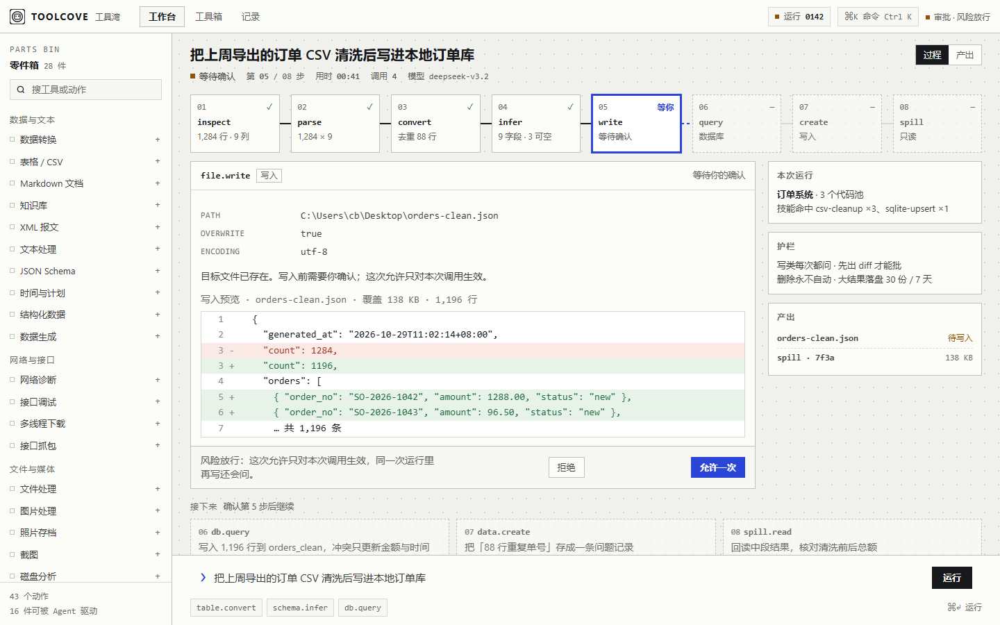

# ToolCove · 方向 B「Pipeline」成品原型

用户选定的方向：**B · Pipeline**（原话「B」，记录在 [../direction-approved.md](../direction-approved.md)）。
这一版把三个方向里的 demo 收口成**一套可点的应用**：工作台 / 工具箱 / 记录，共用同一套语言。

打开：[index.html](index.html)（纯静态、离线、无依赖）。

## 这一版和方向 demo 的差别

- 字号与对比度按 skill 底线收口：**正文 14px、标签 12px、正文对比度 ≥4.5:1**（`design_lint.py check` 现在 0 红）。
- 补齐另外两屏：工具箱（28 件工具 → 目录 + 工具详情抽屉）、记录（速记/问题 → 列表 + 详情）。
- 顶栏改成模块切换（工作台 / 工具箱 / 记录），左边栏随模块换内容：零件箱 / 分组索引 / 记录类型。
- 同一个「运行 0142」贯穿三屏：工具箱里加工具会回到工作台的目标框，记录里「交给 Agent」也一样。

## 能点的

- **第 5 步闸门**：允许一次 → 06-08 依次点亮，链条接通，产出变「已写入」；拒绝 → 停在原地并说明磁盘没动。
- **节点**：点链条上任意一步，检查器换成那一步的参数与结果。
- **过程 / 产出**：右上分段控件，产出页列这次运行留下的两个文件。
- **工具箱**：搜索、分组筛选、点卡片开右侧抽屉（动作列表 / 打开窗口 / 加进管线）。
- **记录**：左列切换，右列详情；「复制」「交给 Agent」。
- **⌘K**：动作、工具、记录、界面一起搜；选中动作会填进目标框。
- 1440×900 与 1120×760 都验过：短屏时链条与面板压缩，闸门永远在首屏可见。

## 落地到仓库要动的地方

1. **令牌**：`tokens.css` 加 `--canvas #f1f2ed` / `--plate #fcfcf9` / `--line` / `--signal-blue #2b45d8`；正文 14、标签 12 进刻度表（`uiSpec` 那张表要重生成）。
2. **原语**：`primitives.css` 新增 ` .tc-chain / .tc-node / .tc-gate / .tc-diff` 四个族；原型里的 `.chain / .node / .gate / .diff` 是草稿。
3. **AgentView**：执行记录改成横排链 + 检查器；确认从弹窗改成节点里的行内闸门（会动 approval 与 e2e，单独一轮）。
4. **ToolboxView**：分组大卡改成目录网格 + 详情抽屉；动作数、仅桌面标记来自 registry。
5. **RecordsView**：两栏列表/详情，沿用现有 snippet/problem 数据。
6. **手机端**：窄屏退化为竖排链（横滑）+ 全屏抽屉，另行设计，不在这一版。

## 边界

- 数据是示例（订单 CSV、运行 0142、记录条目、模型名）。
- 工具窗口、真实 diff 计算、i18n、暗色主题未做；暗色可在同一骨架上换一套 `--canvas/--plate` 令牌，结构不动。
